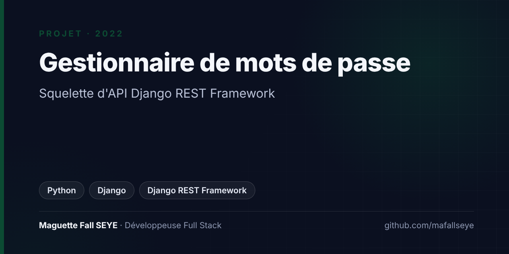

<p align="center"></p>

# Gestionnaire de mots de passe

Gestionnaire de mots de passe.

## Fonctionnalités

- Projet Django initialisé avec Django REST Framework

## Technologies

Python · Django · Django REST Framework

## Lancer le projet

Prérequis : Python 3.10 ou plus.

```bash
git clone https://github.com/mafallseye/flask.git
cd flask
python -m venv .venv
source .venv/bin/activate   # Windows : .venv\Scripts\activate
pip install -r requirements.txt
cd passwordManager
python manage.py migrate
python manage.py runserver
```

> Projet réalisé en 2022 pendant ma formation. Il est conservé ici comme trace de mon parcours.

## Auteure

**Maguette Fall SEYE** — Développeuse Full Stack, Dakar (Sénégal) · [github.com/mafallseye](https://github.com/mafallseye)
